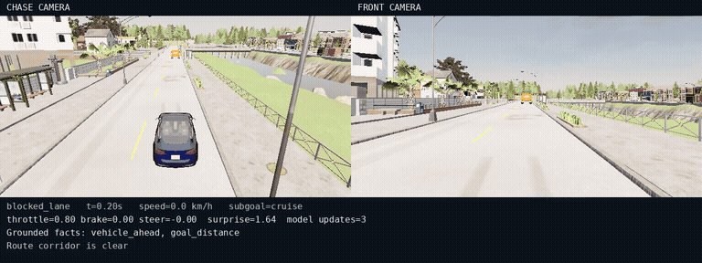
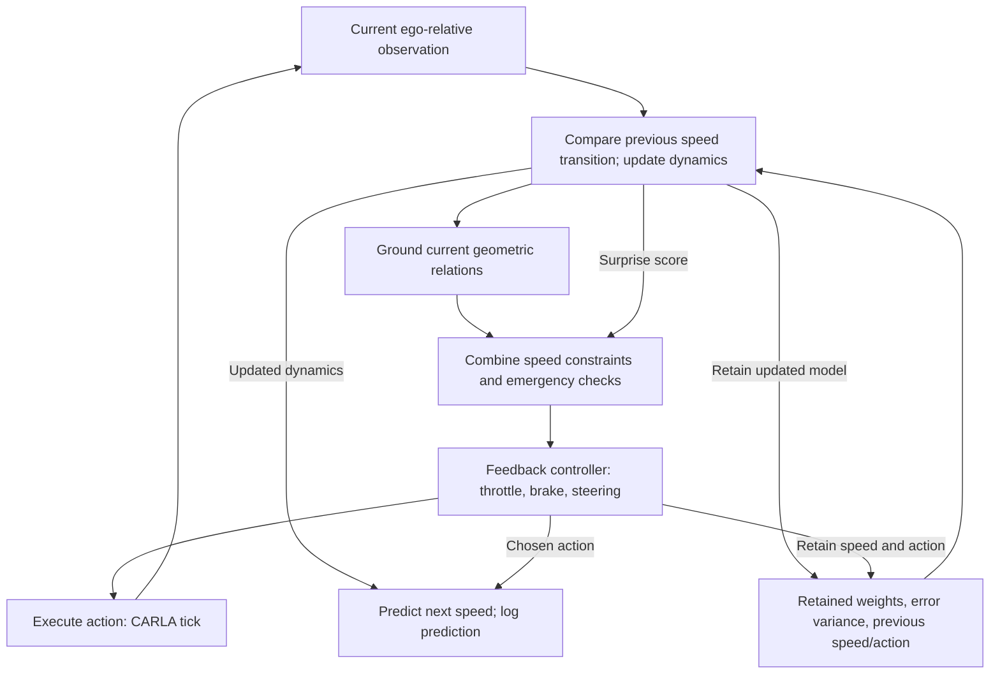

# Grounded symbolic driving in CARLA

I am interested in a specific question: what can a driving policy reuse when the town, actor identity, and vehicle change, but the relation that matters stays the same?

A parked truck becomes an instance of `vehicle_ahead`, with a clearance, a speed, and a stopping constraint. The same following rule can then operate on it. When the truck leaves, the relation disappears and the controller resumes.

This project makes that idea executable: geometric observations become symbolic relations, relations impose numerical constraints, and a feedback controller produces driving actions. A small neural residual adapts to the observed speed transitions. The broader question is how learned representations could retain this explicit, checkable meaning.

## Watch the policy

[](docs/media/blocked-lane.mp4)

**Preview at 2× speed; click for the full-speed blocked-lane recording.** Also watch [pedestrian yielding](docs/media/pedestrian.mp4), [red-light stop and resume](docs/media/red-light.mp4), and [lane following](docs/media/lane-follow.mp4).

These are CARLA camera recordings with policy annotations. The controller receives simulator geometry; camera perception is future work.

## What runs each tick



System 2 grounds and plans, System 1 controls, and System M adapts the dynamics model. All run in one synchronous 20 Hz loop. GPT-6 Astra authored the implementation; the runtime executes Python.

The policy is $(a_t,m_{t+1})=\Pi(o_t,m_t)$: memory matters because previous dynamics errors can change the current target. The next-speed prediction is logged; the next tick recomputes the transition error using retained model state and the previous speed/action. The first tick has no previous transition.

## The math behind the symbols

The grounder projects actors onto the route polyline. Along-route position $s$, actor length $L$, and ego speed $v$ give front clearance and closing speed:

$$
d=\max(0,s-L/2-2.3),\qquad c=\max(0,v-v_x).
$$

Here $v_x$ is the actor's absolute velocity projected into ego-forward axes. Closing TTC is $d/c$ when $c>0.1$. Route occupancy and actor kind ground `vehicle_ahead`, `pedestrian_in_path`, or `obstacle_ahead`. A separate constant-velocity forecast samples four seconds ahead to ground crossing conflicts.

Each fact proposes a speed constraint. Stopping envelopes use

$$
q(d)=\sqrt{2a_b\max(0,d-m)},
$$

with deceleration parameter $a_b$ and margin $m$. Signals use $(a_b,m)=(2.5,2.5)$; pedestrian and crossing constraints use $(3,4)$, with acceleration in m/s² and distance in metres.

For a lead vehicle with stored forward speed $v_a$,

$$
d_{\mathrm{desired}}=4+1.5v,
$$

$$
q_{\mathrm{follow}}=\min\left[
v_a+0.5(d-d_{\mathrm{desired}}),
v_a+\sqrt{6\max(0,d-3)}
\right].
$$

With valid nonnegative limits, the nominal target is the minimum of the speed/curvature cap and clamped candidate speeds. Emergency conditions across all applicable facts can override it with full braking. Pure-pursuit steering tracks the route; longitudinal feedback tracks the selected speed.

At 8 m/s, a stationary vehicle with 20 m of clearance gives a desired gap of 16 m and a target of 2 m/s. That calculation works with a new actor binding. Its braking assumptions remain approximations, not a safety proof.

## What is being reused

The reusable programs are the grounding predicates, numerical constraints, and conditional control rules. Each observation binds them to current geometry.

A `yield` decision describes `brake_before_conflict → verify_corridor_clear → resume_route`. These strings explain behavior; the controller recomputes its decision each tick rather than advancing a program counter through them. Resume follows from a constraint disappearing or relaxing.

The policy does not learn new programs. It reuses implemented relations across actor identities and equivalent ego-relative scenes. Regression tests cover identity changes and translated/rotated scenes. That gives me a concrete mechanism to investigate: preserve the operation while changing its bindings.

## What the dynamics model learns

System M adds a bounded neural residual, $r_\theta\in[-2,2]$ m/s², to a physical prior:

$$
\hat v_{t+1}=\max\left(0,v_t+[3T-7B-0.12v_t+r_\theta(v_t,a_t)]\Delta t\right).
$$

The two-layer network updates online. For acceleration error $\epsilon$, the anomaly score is $S=\epsilon^2/[2\max(0.25,\sigma^2)]$. When $S>4.5$, the valid-route planner scales its new target by 0.7.

This measures ego-dynamics mismatch. In the Town02 truck episode, the policy braked with a score of just 0.00962: the grounded relation supplied the reason to react. The exposed bicycle rollout is not used for action search or model predictive optimization.

## Evidence and limits

The 4 October 2026 mathematical report records:

- **Five original episodes passed:** lane following, blocked lane, pedestrian, red light, and a newly appearing Town02 truck with a different ego vehicle.
- **Zero recorded collisions or lane invasions**, across 499.45 m of nominal routes.
- **16 regression tests passed; 3,812 decisions replayed** across nine traces within $10^{-10}$ tolerance.

Four traces are correlated camera reruns. The experiments use privileged geometry and controlled scenarios, with relatively straight route starts. They do not establish dense-traffic competence, camera perception, overtaking, intersection negotiation, or formal safety. Replay agreement establishes implementation consistency.

## Quickstart

Use Python 3.12, `uv`, and Docker with NVIDIA GPU support. The CARLA image needs roughly 30 GB. From the repository root:

```bash
uv venv --python 3.12 .venv
uv pip install --python .venv/bin/python -e '.[carla,dev]'
.venv/bin/python -m pytest -q
docker pull carlasim/carla:0.9.16
bash scripts/start_carla.sh
# Wait for the simulator world to load.
.venv/bin/python -m grounded_drive.runner \
  --scenario pedestrian --output reports/pedestrian
```

For simulator-free development, install `.[dev]` and run the same pytest command.

Each run writes `trace.jsonl` and `summary.json`. Run one synchronous client per server. For all five scenarios, use a separate Town02 server to avoid the observed map-reload crash:

```bash
CARLA_NAME=grounded-drive-town02 CARLA_PORT=2010 CARLA_TOWN=Town02 \
  bash scripts/start_carla.sh
# Wait for Town02 to load.
.venv/bin/python scripts/evaluate.py --heldout-port 2010
```

## Next: representations with checkable meaning

I want to test an encoder $z_t=E(I_t)$ and action-conditioned predictor $\hat z_{t+1}=F(z_t,a_t)$ whose outputs also recover actor state, grounded relations, and constraint attributes.

The next interventions are aligned raw-image/state logging, held-out route and interaction families, and explicit predicate contracts. A learned model could propose action sequences; a symbolic checker could evaluate their predicted consequences under stated uncertainty assumptions.

That architecture remains future work. The current policy supplies a small executable vocabulary for asking whether a representation preserves the meaning needed to act.
